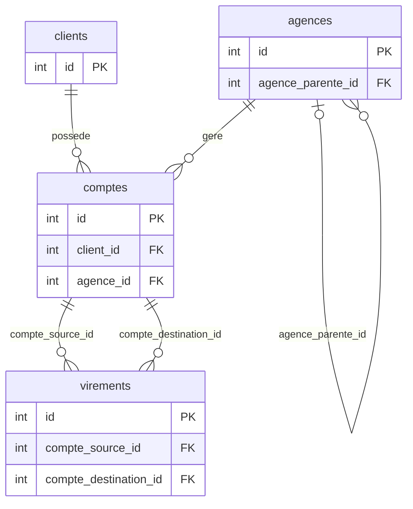

# projet-sql-banque


## Présentation

Ce projet modélise une banque à l'aide d'une base de données PostgreSQL.
Il regroupe des clients, leurs comptes, les agences bancaires et les virements.
Les données fictives permettent d'explorer l'activité de la banque sur plusieurs mois.
Les requêtes SQL servent à analyser les soldes, les virements et les performances des agences.

### Objectif pédagogique et analytique

Ce projet sert de support à un cours de SQL sur PostgreSQL : à partir d'un jeu de
données fictives, il permet de pratiquer les jointures, les agrégations et les
fonctions de fenêtre. L'objectif analytique est de comparer l'activité des
agences, d'étudier la répartition des soldes et de suivre les virements dans le
temps. Le dossier `requetes.sql` contient les analyses à exécuter après le
chargement des données.


# Tables :

## table clients :
Cette table contient les clients de la banque et leurs informations d'inscription.
- `id` : identifiant unique du client.
- `nom` : nom du client.
- `prenom` : prénom du client.
- `email` : adresse e-mail.
- `date_inscription` : date d'arrivée du client dans la banque.

## table comptes
Cette table représente les comptes bancaires, leur titulaire, leur agence et leur solde.
- `id` : identifiant unique du compte.
- `client_id`
- `agence_id` : agence qui gère le compte.
- `type_compte` : courant, épargne, etc.
- `solde` : argent disponible sur le compte.
- `date_ouverture` : date de création du compte.

## table virements
Cette table enregistre les transferts d'argent entre deux comptes et leur statut.
- `id` : identifiant unique du virement.
- `compte_source_id` : compte qui envoie l'argent.
- `compte_destination_id` : compte qui reçoit l'argent.
- `montant` : somme transférée.
- `date_virement` : date du transfert.
- `statut` : en attente, effectué ou refusé.

## table agences
Cette table décrit les agences et permet de représenter leur hiérarchie.
- `id` : identifiant unique de l'agence.
- `nom` : nom de l'agence.
- `ville` : ville où se trouve l'agence.
- `adresse` : adresse de l'agence.
- `agence_parente_id` : identifiant de l'agence dont elle dépend.

### Comment lire les tables

- **`clients`** : un client est identifié par `id` et peut posséder plusieurs comptes.
- **`comptes`** : chaque compte appartient à un client (`client_id`) et à une agence (`agence_id`). Son type est limité à `courant` ou `epargne`.
- **`agences`** : une agence peut dépendre d'une autre agence via `agence_parente_id` ; une valeur `NULL` désigne une agence sans parente, comme le siège central.
- **`virements`** : chaque ligne représente un transfert entre deux comptes distincts, avec un montant strictement positif et un statut parmi `effectue`, `en_attente` et `refuse`.

Les colonnes `id` sont des clés primaires. Les champs qui pointent vers une autre
table sont des clés étrangères ; ces contraintes sont définies dans `schema.sql`.


## Relations entre les tables :
- `comptes.client_id` → `clients.id`
- `comptes.agence_id` → `agences.id`
- `virements.compte_source_id` → `comptes.id`
- `virements.compte_destination_id` → `comptes.id`
- `agences.agence_parente_id` → `agences.id`

```text
clients (1) ──< comptes >── (1) agences
                  │
                  ├──< virements (via compte_source_id)
                  └──< virements (via compte_destination_id)

agences (parente) (1) ──< agences (enfants)
```

### Schéma relationnel (Mermaid)



Chaque virement référence obligatoirement un compte source et un compte
destination. Chaque compte dépend d'un client et d'une agence. Une agence peut
avoir zéro ou une agence parente et plusieurs agences filles.


## Installation

Les commandes suivantes sont à saisir dans **SQL Shell (psql)**. Elles créent
une base neuve, puis y créent les tables et chargent les données fictives.
Remplacez `C:/chemin/vers/projet-sql-banque` par le chemin de ce projet sur
votre ordinateur.

```sql
CREATE DATABASE banque;
\c banque
\i 'C:/chemin/vers/projet-sql-banque/schema.sql'
\i 'C:/chemin/vers/projet-sql-banque/seed.sql'
```
!! Faites gaffe a ne pas avoir d'espaces dans le chemin du fichier !!


Le jeu de données est prévu pour une base vide. N'exécutez pas de nouveau
`seed.sql` sur une base déjà remplie : le script insère à nouveau les données
et n'est pas conçu pour être relancé.

## Vérification

Après le chargement, cette requête indique le nombre de virements et la période
couverte par leurs dates :

```sql
SELECT
    COUNT(*) AS nombre_virements,
    MIN(date_virement) AS premiere_date,
    MAX(date_virement) AS derniere_date
FROM virements;
```

Avec le jeu de données fourni, le résultat attendu est **120 virements**, du
**2026-07-01** au **2026-09-30** inclus.
